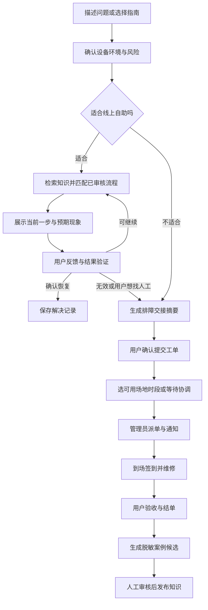
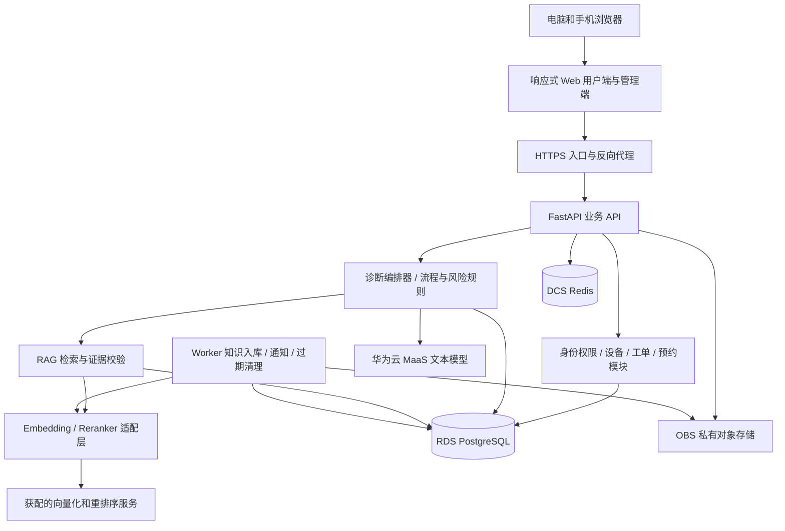

# 知修：电脑义诊系统完整设计方案

版本：V1.0｜设计日期：2026-10-29｜交付性质：产品与技术设计，尚未实施或部署。

项目名称“知修”为暂定名称，可替换。定位：面向校园电脑义诊的 AI 辅助排障与维修服务平台。

## 1. 项目定位与设计前提

一句话说明：用户描述电脑问题，系统基于可信知识逐步指导排查；无法自助解决时，携带完整排查记录转为预约与维修工单；维修结果经审核后补充知识库。

核心服务链：**问题描述 → 风险与环境确认 → 检索可信资料 → 一步一步教学 → 验证结果 → 预约人工 → 现场维修 → 用户验收 → 经验沉淀。**

本方案默认首批用户来自一所高校，维修服务由校园技术社团或信息技术志愿团队提供；优先覆盖 Windows 11 常见问题；开发团队约 3～4 人，预留 8 周完成可演示与小范围试用的版本。这些是排期假设，不是已知事实。第一版为响应式 Web，电脑和手机浏览器均可使用，后续通过同一套业务 API 扩展小程序、App。

应优先验证的三个问题：用户能否看懂并完成指导；线下维修人员是否愿意使用工单；已有知识能否覆盖高频问题。界面规模、模型数量、文档总量均不能代替这三个验证。

### 1.1 产品价值

| 对象 | 当前痛点 | 系统提供的价值 |
|---|---|---|
| 普通用户 | 不知道故障叫什么、网上教程难判断、担心误操作 | 按现象描述，获得适用且可验证的分步指导 |
| 维修志愿者 | 每次从头问起、记录分散、到场设备情况不清 | 提前看到设备情况、已尝试操作与结果，减少重复沟通 |
| 义诊负责人 | 预约冲突、人员安排混乱、难统计效果 | 按场地和排班发布名额，统一派单、跟踪与复盘 |
| 参赛团队 | AI 功能容易停留在聊天演示 | 展示知识支撑、流程控制、真实业务写入与线下交付的完整链路 |

### 1.2 首版范围

**必须做：**常见问题指南、文字问诊、基础图片上传、流程式排障、证据来源、会话保存与恢复、人工转接摘要、预约、工单、排班与地点、基础知识审核、权限、运行统计。

**增强项：**截图 OCR/视觉识别、跨设备继续排障、案例知识候选生成、RAG 对照实验、短信通知、轻量 PWA。

**后续项：**小程序/原生 App、多个学校独立运营、原生硬件诊断助手、经授权的远程协助、备件与收费流程。

第一版不建设自动远程控制能力。普通网页无法直接读取完整硬件健康、任意系统日志、注册表或直接执行本机维修命令；用户手动确认的信息与自主上传的材料才是诊断输入。产品界面不可出现“已自动扫描你的硬盘”等不实文案。

## 2. 与截图中的参赛要求对应

以下赛事要求来自用户提供的截图，仅将其作为本次设计的输入；不据此推断完整赛制、评分权重、截止日期或具体资源额度。

| 截图要求 | 本项目安排 | 应留存的展示证据 |
|---|---|---|
| 使用华为云码道 CodeArts 代码智能体 | 用于需求细化、页面和接口开发、缺陷修复、测试与部署脚本编写 | 实际使用记录、对应提交、问题修复前后对比 |
| 基于智能体和 Skills 开通关联 RDS、Redis 等云服务 | 在实际获配账号内，使用适用的云资源与部署 Skills，形成环境配置与开通流程 | 脱敏资源清单、Skill 执行记录、连接验证 |
| 作品部署在华为云，提供可视化 Demo | 云上运行前端、业务 API、Agent、数据库与存储 | 可访问演示入口、部署记录、版本号、演示录像 |
| 体现需求理解到部署上线的使用价值 | 选择真实需求和缺陷，展示 CodeArts 如何参与完成 | 需求—代码—测试—部署的关联证据 |
| 入围相关决赛作品需开源 | 预备源码、依赖锁文件、部署指南、使用说明、许可证、截图或视频 | 可复现仓库与脱敏示例数据 |

注意两种 Agent 的区别：**CodeArts 是研发工具；知修诊断 Agent 是产品功能。**使用 CodeArts 开发并不自动等于具备面向终端用户的诊断运行服务。官方文档介绍了 CodeArts 的 Skills 使用能力，具体可用 Skill 与适配范围应在实际开发环境验证。[CodeArts 技能文档](https://support.huaweicloud.com/usermanual-codeartsagent/codeartsagent_ug_0024.html)

截图中提到的云资源发放时间、额度及有效期，以组委会最终通知与团队账号实际权益为准。设计不依赖未经确认的免费模型额度或指定地域可用性。

## 3. 用户角色与权限

| 角色 | 主要能力 | 数据范围 |
|---|---|---|
| 游客 | 浏览公开指南、开始受限的临时问诊 | 当前临时会话；预约前完成账号绑定 |
| 普通用户 | 管理设备、问诊、提交工单、预约改期、查看维修进度、评价 | 本人的设备、会话、附件和工单 |
| 维修志愿者 | 查看被分配的工单、接诊、记录检查、申请转交、提交维修结果 | 被授权的工单及必要的排障摘要 |
| 调度管理员 | 发布义诊活动、设置场地排班、分配工单、调整安排 | 所属组织内的服务运营数据 |
| 知识审核员 | 编写、审核、发布、下架指南和排障流程 | 知识内容与脱敏案例，不默认获得全部联系人信息 |
| 系统管理员 | 账号与角色、系统配置、模型与运行监控 | 配置管理权限；敏感内容读取仍需明确授权并记审计 |

同一个人可以兼任角色。所有权限在后端校验，隐藏前端菜单不能代替权限控制。维修人员查看用户手机号时按任务需要授权，列表默认掩码显示。

首版建议以邮箱验证或校园可用的登录方式建立账号；演示提供独立的用户、志愿者与管理员测试账号。手机号仅在确需预约联系时收集，校园统一身份认证作为后续集成项。

## 4. 完整业务流程



### 4.1 用户侧操作顺序

1. 首页选择“描述我的问题”“按分类找教程”“预约人工义诊”。始终允许直接选择人工，不强迫先完成 AI 问诊。
2. 输入自然语言，例如“笔记本连上 Wi-Fi，但网页打不开”。可以附截图，系统提供裁剪和隐藏敏感信息的入口。
3. 分轮确认关键环境：操作系统、问题开始时间、影响范围、近期改动。每轮优先问 1～2 个能改变排查路径的问题，不先发十几项表单。
4. 先做风险筛查，再给出一张操作卡。每张卡只承担一个操作目的。
5. 用户点选“已恢复”“还是不行”“找不到这个选项”“不方便操作”，或补充文本/图片。
6. 依据反馈继续、解释、切换分支或转人工；已经失败的步骤不会无理由重复出现。
7. 修复后请用户完成一次针对性验证，再确认解决；未确认的会话不能记为已解决。
8. 转人工时展示摘要供用户修改、确认。提交后的工单与会话建立关联。
9. 选择已开放的服务点与时段；无可用名额时进入待协调，不伪造预约成功。
10. 到场出示签到码，维修后确认结果并评价；相同问题复发可发起复开申请。

### 4.2 典型场景

| 场景 | 交互路径 | 验证重点 |
|---|---|---|
| 外放无声音，输出设备选错 | 识别环境 → 查看输出设备 → 调整 → 播放测试音 | 真实验证恢复后才结案 |
| 电脑无法联网 | 比较其他设备网络情况 → 选择适用分支 → 指导与反馈 | 区分单机故障、校园认证、上游网络问题 |
| 多次低风险排查仍无效 | 汇总症状、尝试记录与未确认事项 → 转人工 | 用户不必重新描述；维修员能接续检查 |
| 电池鼓包、进液、焦味等现象 | 停止一般自助流程 → 显示已审核的安全提示和合适服务渠道 | 不继续给出重启、拆机或通电测试建议 |
| 电脑黑屏但手机能上网 | 手机访问 Web → 选择电脑为故障设备 → 文字/图片输入 | 不把访问网页的手机当作故障设备 |

具体维修内容上线前需要有经验的人员审核，本方案中的网络与声音案例用于描述产品行为，不构成完整维修手册。

## 5. 用户端页面与交互设计

### 5.1 信息架构

| 页面 | 路由示例 | 核心内容与主要动作 |
|---|---|---|
| 首页 | `/` | 问题输入框、高频问题、人工义诊入口、正在开放的活动 |
| 问题指南库 | `/guides` | 分类、系统版本筛选、搜索、预计时间、难度、风险标记 |
| 指南详情 | `/guides/:id` | 适用环境、前置条件、步骤、验证、回退说明、来源、更新时间 |
| 智能排障工作台 | `/diagnosis/:id` | 对话、当前操作卡、已尝试记录、资料来源、转人工 |
| 设备与历史 | `/my/devices`、`/my/sessions` | 设备档案、已解决记录、继续上次会话 |
| 预约页面 | `/appointments/new` | 问题摘要、服务点、时段、联系人、携带清单 |
| 我的服务 | `/my/tickets` | 工单列表、待确认事项、预约和维修状态 |
| 工单详情 | `/tickets/:id` | 时间线、预约卡、维修记录、改期取消、验收和复开申请 |

首页主文案建议：“电脑遇到问题？描述一下，我们陪你一步步排查。”主要输入示例：“电脑很卡”“Wi-Fi 连上却不能上网”“耳机有声音，扬声器没声音”。

### 5.2 排障工作台布局

桌面端三栏：左侧会话与已尝试步骤约 240px，中间对话与操作卡为主区域，右侧设备信息、风险与依据约 300px。窄屏将两侧收进抽屉，优先保证操作卡和反馈按钮。

```text
┌──────────────────────────────────────────────────────────┐
│ 知修   问题指南   我的服务                    我的账号      │
├──────────────┬───────────────────────────┬───────────────┤
│ 本次排查      │ Wi-Fi 已连接，网页打不开    │ 当前设备       │
│ ✓ 确认环境    │ 当前一步：确认影响范围       │ Windows 11    │
│ ● 网络范围    │                           │ 笔记本        │
│ ○ 等待反馈    │ 请用另一台设备连接同一网络… │               │
│              │ 说明 + 示意图 + 预期现象    │ 已知事实       │
│ 已尝试记录    │                           │ 仅网页异常…    │
│              │ [也不能上网] [可以上网]     │               │
│              │ [没有其他设备] [转人工]     │ 依据与适用范围 │
├──────────────┴───────────────────────────┴───────────────┤
│ 补充情况或上传截图…                              发送      │
└──────────────────────────────────────────────────────────┘
```

每张操作卡应包含：步骤名称、为什么做、操作入口、图示、预期现象、结果选项、风险与回退说明、来源。中风险操作额外展示影响范围和确认按钮。系统不要把整段模型文本直接作为可执行操作卡。

“已完成操作”与“问题已解决”是两个独立事件。点击完成一步后，还要按该步骤要求反馈结果。遇到“找不到这个选项”，先确认系统版本、语言或设备环境，再显示替代路径，不盲目跳下一步。

### 5.3 预约界面

顺序：确认排障摘要 → 选地点与时段 → 联系与到场说明 → 确认提交。显示完整地点名称、楼栋房间、服务时间、服务范围、是否需要携带电源、可用名额。地图导航可以后续接入，首版用清楚的地址与场地图片即可。

用户提交前应知道：这是预约初诊/维修服务，预计时长是计划值，不能承诺所有问题都当场修好；需要额外备件或校外服务时另行沟通。义诊默认不含在线支付，任何可能产生的费用应由人工明确说明并获得用户确认。

### 5.4 视觉与可用性

建议使用浅色背景、深蓝文字、蓝绿色主色；绿色表示已验证恢复，橙色表示需要注意，红色仅用于严重风险或错误。状态同时配文字和图标，不能只靠颜色区分。

面向电脑知识有限的人：正文建议 16px 左右；按钮触达区域至少约 44px；操作文案使用系统界面真实名称；图示支持放大；提供键盘操作与清晰焦点；支持浏览器字体放大。用户正在执行时，页面不能自动滚动覆盖当前步骤。

手机端底部导航采用“首页、排障、服务、我的”，输入区与按钮避开软键盘。支持刷新恢复与重连。跨设备继续会话应登录验证或使用短时、一次性授权码，不在公开二维码中直接携带完整诊断内容。

## 6. 管理后台与维修工作台

| 模块 | 核心能力 | 必须处理的细节 |
|---|---|---|
| 运营概览 | 待处理、今日预约、到场、超时、已解决、转人工数量 | 区分测试与真实数据，明确统计时间范围 |
| 工单中心 | 筛选、派单、优先级、标签、时间线、批量提醒 | 风险高不一定能由志愿者承接，应支持转专业服务 |
| 预约日历 | 按地点/人员/日期展示，改期、取消、停诊 | 不允许静默修改用户已确认的安排 |
| 服务活动 | 活动日期、场地、服务项目、人数上限、开放状态 | 未发布的活动不能预约，停诊影响通知到人 |
| 人员排班 | 技能、值班时间、可承接工单数、请假替补 | 同一人员不能被重复排入冲突服务时间 |
| 维修工作台 | 查看交接摘要、签到、检查记录、维修结果、待用户确认 | 必须区分用户陈述、AI 推测、现场确认 |
| 知识管理 | 指南、流程节点、引用资料、审核、发布、回滚 | 版本控制和过期复审，危险内容快速下架 |
| AI 运行中心 | 模型、提示模板版本、检索评测、调用费用、错误与延迟 | 仅授权维护人员可操作，密钥不回显到浏览器 |
| 用户与权限 | 角色分配、账号状态、操作审计 | 限制工单导出与敏感资料查看 |

工单详情建议布局：左侧症状和排障摘要，中间维修时间线，右侧预约、负责人及待办操作。详情直接显示“用户已做过什么”，并允许维修员标注某项结果不可靠，需要复测。

维修记录结构：检查项目、观察结果、判定原因、执行处理、使用备件（可空）、验证方法、当前结论、后续建议、记录人、时间。原因允许“尚未确认”，不得为了结单强制填写虚构的根因。

手机浏览器也应能使用维修工作台，方便现场扫描签到码、记录检查结果和上传必要照片。

## 7. 常见问题库与标准排障流程

知识库由三种内容组成：**面向用户的图文指南、供流程引擎执行的标准排障流程、用于佐证和解释的原始资料及脱敏案例。**三者通过版本和引用关系关联，不能把所有文档切片后就当成完整产品。

### 7.1 首批问题覆盖

| 分类 | 建议首批问题 | 线上指导范围 |
|---|---|---|
| 网络 | Wi-Fi 不显示、连接无网、网页打不开、校园网认证异常 | 环境确认、状态检查、已审核的设置调整 |
| 声音与外设 | 无声音、麦克风不可用、耳机切换、摄像头权限、鼠标异常 | 设备选择、权限与连接排查 |
| 显示 | 外接屏无画面、分辨率异常、缩放与亮度问题 | 连接方式与显示设置检查 |
| 性能与空间 | 开机慢、应用卡顿、存储空间不足 | 查看资源与存储情况、识别可处理范围 |
| 应用 | 软件打不开、闪退、文件关联异常、安装报错 | 报错收集、适用条件确认、官方方案 |
| 系统与硬件预警 | 蓝屏、无法启动、异常高温、供电异常 | 记录现象与风险判断，复杂场景转人工 |

首版目标为约 30 个高频问题、10～15 条完整排障流程、50～100 条可追溯知识条目；不把达到条数当作质量达标。优先投入网络、声音、显示、权限等可验证且风险较低的场景。

### 7.2 流程节点规范

流程采用有向图，节点类型包括：提问、观察、操作、验证、解释、转人工、结束。每个节点至少保存：

| 字段 | 含义 |
|---|---|
| `node_id / flow_version` | 稳定节点标识与所属不可变流程版本 |
| `applicability` | 操作系统、版本、设备类型、必要条件 |
| `prompt / instruction` | 提问或经过审核的操作说明 |
| `risk_level` | 观察、可逆变更、高风险/人工范围 |
| `expected_observation` | 用户应观察到的现象 |
| `result_options / transitions` | 允许的反馈选项及合法下一个节点 |
| `stop_conditions` | 出现什么情况应立即停止该流程 |
| `rollback` | 已改变设置后的恢复方法，无变更则为空 |
| `source_refs` | 原始来源、知识版本、审核人员 |

发布校验：入口存在；分支有终点；无意外死循环；高风险节点不能进入普通用户自助路径；每个可执行节点均有适用条件和验证方式；图片与来源可访问；流程变更经过审核。

已有会话固定引用启动时的流程版本，普通更新不让流程中途漂移；但涉及安全问题的版本撤回必须覆盖旧会话，暂停有关步骤并提示转人工。

## 8. Agent 设计：让模型理解，让系统控制流程

推荐首版采用一个诊断编排器，加专用工具与明确状态机。症状归类、澄清问题、资料解释、摘要生成可以由模型协助；风险门禁、流程跳转边界、权限、工单提交和预约容量由业务代码控制。

LangGraph 可作为实现选项，因为其支持有状态流程、流式交互与人工介入；若团队不熟悉，使用清晰的 Python 状态机也能完成首版。框架不是创新点，正确处理状态与边界才是。[LangGraph 官方说明](https://docs.langchain.com/oss/python/langgraph/overview)

### 8.1 会话状态

`INTAKE → CLARIFY → RETRIEVE → GUIDE → VERIFY`，随后进入下一步、`RESOLVED` 或 `HANDOFF`；任意阶段可进入 `PAUSED`。另外记录结束原因 `user_exit / timeout / resolved / handoff`，用户离开不能等同修复成功。

持久化字段包括：账号及故障设备、已确认事实、用户原话、症状分类、风险标记、当前流程版本和节点、已尝试步骤与结果、引用知识、未确认事项、转人工原因、状态版本号。不要只靠完整聊天文本让模型自行回忆。

在一个会话里出现第二个独立问题时，询问用户是否开启新会话或作为关联问题记录；避免把“不能联网”和“键盘损坏”的结果混成同一条诊断路线。

### 8.2 每轮处理

1. 服务器读取会话和最新用户反馈，检查访问权限、消息去重及状态版本。
2. 执行风险规则；必要时直接进入人工分流，不能等模型自由回答后才补警告。
3. 从用户输入抽取环境和现象，区分事实、猜测和缺失信息。
4. 若缺少会改变步骤的关键条件，先追问；否则检索适用知识和流程。
5. 编排器选出合法候选节点；模型只能解释或在候选范围内提出选择。
6. 将输出校验为结构化数据，验证来源存在、流程合法、风险等级符合政策。
7. 渲染已审核的步骤内容，并保存步骤实例与引用。
8. 收到反馈后校验观察结果，再推进状态；需要写业务数据时走独立的确认与事务接口。

示例返回结构：

```json
{
  "session_id": "session_demo_001",
  "state": "GUIDE",
  "flow_version": "network-scope-v1",
  "step_id": "check_other_device",
  "risk_level": "observe",
  "title": "确认是不是只有这台电脑无法上网",
  "instruction_ref": "network-scope-v1/check_other_device",
  "expected_feedback": ["other_device_ok", "other_device_failed", "cannot_check"],
  "evidence_status": "reviewed_flow_matched",
  "citation_ids": ["kb_demo_network_01_v1"],
  "can_handoff": true
}
```

这些 ID 是结构示例，正式系统必须关联真实发布记录。前端根据 `instruction_ref` 读取已审核步骤；模型生成的补充解释不能覆盖关键操作、命令和禁止条件。

### 8.3 工具与权限

| 工具 | 用途 | 权限与限制 |
|---|---|---|
| `search_knowledge` | 检索适用知识 | 只读，仅允许访问当前用户可见的已发布知识 |
| `get_flow_node` | 读取标准流程节点 | 只读，检查版本和节点可达性 |
| `save_observation` | 保存用户反馈 | 只写当前会话，校验事件去重与版本 |
| `list_service_slots` | 查询地点和时段 | 只读，结果来自实时预约服务 |
| `draft_handoff` | 生成排障交接草稿 | 不等于提交工单，不占预约名额 |
| `submit_ticket` | 提交工单 | 用户确认草稿后由业务接口执行 |
| `hold_slot / confirm_booking` | 预留和确认预约 | 服务器验证本人、容量、时效与确认凭证 |

模型拿不到管理员账号、数据库连接串和任意 SQL/终端执行工具。工具调用不继承模型声称的角色，全部沿用真实用户的服务器身份。

### 8.4 证据不足与转人工

不用模型自报的“90% 置信度”决定安全。判断基于：环境信息是否足够、是否命中适用流程、来源质量、关键症状覆盖、来源冲突、结果是否可验证。可以展示“适用指南已匹配”或“依据不足，需要人工确认”。

以下情况触发转人工建议：高风险现象；需要拆机、刷固件、重装、数据恢复等超出自助范围的操作；没有适用知识；连续 2～3 个有效步骤失败且没有新线索；同一操作重复无效；用户表示疲劳或主动找人工。次数只是初始配置，按试用调整，不能把“多问几轮”当作服务质量。

高风险操作的控制应按动作与情境判断，例如涉及系统重置、磁盘格式化、保护关闭的步骤默认不进入普通用户自助流程。即使用户在聊天中说“我同意”，也不能绕过组织规定的人工处理边界。

### 8.5 人工交接摘要

交接单包含设备与系统、用户描述、发生时间、影响范围、已确认事实、已尝试步骤及结果、相关截图、风险提醒、未确认事项、转人工原因。模型推测单列为“待验证假设”，不可写成已确定故障原因。

例：用户报告“同一 Wi-Fi 下手机正常，电脑网页打不开”；已确认“浏览器 A、B 均失败”；已尝试“确认系统代理设置，问题仍存在”；待确认“校园认证状态与网络配置”；转人工原因“可执行的低风险流程已完成”。维修员接单后在此基础上继续检查。

## 9. RAG 知识工程

### 9.1 来源与审核

优先顺序：操作系统与设备厂商官方资料 → 团队审核的标准操作流程 → 有验证记录的脱敏维修案例 → 仅供线索参考的社区材料。社区文章不直接变成可执行步骤。保存来源链接、采集时间、适用环境、使用许可或引用方式、审核人和知识版本。

生产问诊不临时抓取任意网页补答案。外部资料通过离线导入、清洗与审核进入知识库，减少错误教程、提示注入与过期操作混入。

### 9.2 离线入库

```text
资料收集 → 来源与可用性检查 → 文本/图像提取 → 去重与脱敏
→ 按故障和操作步骤划分 → 补充元数据 → 人工审核
→ 向量化与关键词索引 → 构建新索引版本 → 回归评测
→ 原子切换发布版本
```

原始资料、图片及流程图存入对象存储；结构化元数据、文本块、版本与向量存入数据库。小知识库先保证内容结构，不必引入多个搜索集群。

分块起点建议：普通知识段约 300～800 个中文字符，视结构调整；一条完整操作、适用条件与警告尽量保留在同一语义单元。超长流程按节点分块，并保留父流程信息。不能将“操作”和其紧邻的风险前提切开后独立推荐。

元数据：`knowledge_id, version, source_url, title, os_family, os_version_range, device_type, symptom_tags, error_codes, risk_level, audience, visibility, reviewer, reviewed_at, expires_at, checksum, embedding_model, embedding_dimension, index_version`。

### 9.3 在线检索

1. 将用户口语转换为故障关键词，同时保留原始报错码与准确短语。
2. 先过滤权限、发布状态、系统版本、设备类型与风险范围。
3. 关键词检索和向量检索并行，初始可各取 15～20 条候选。
4. 按排名融合去重；关键词路线优先保障报错码、设备型号的精确匹配。
5. 对前 10～20 个候选重排序，选择约 3～5 个证据片段。
6. 若命中流程节点，连同父流程的前提、警告、分支一起取回。
7. 检查冲突与证据覆盖；不足则追问或转人工。
8. 返回答案和服务器绑定的引用 ID，记录本轮检索轨迹。

以上数量是待评测的初值，不是性能承诺。中文关键词检索需要中文分词与同义词策略；可在应用层分词后维护小规模 BM25 索引，或使用已验证适配的数据库全文检索方案。不能默认英文分词器对中文有效，也不能把 pgvector 本身当成 BM25 引擎。

首版可采用 RDS PostgreSQL + pgvector；官方文档说明支持向量类型和相似性检索，具体实例仍要验证版本和扩展可用性。[华为云 pgvector 文档](https://support.huaweicloud.com/usermanual-rds-pg/rds_09_0062.html) [pgvector 官方项目](https://github.com/pgvector/pgvector)

### 9.4 更新与防污染

发布状态：草稿 → 待审核 → 已发布 → 需复审/已下架。旧版本保留用于审计，默认检索只用当前有效版本。更换 embedding 模型或维度必须重建索引，不混用不同模型向量。

知识下架时，同时使关键词索引、向量索引、缓存失效；安全撤回还要拦截已开始会话中的相关步骤。发布采用版本切换，避免用户同时读到半新半旧的索引。

维修案例进入知识库前经过：用户可识别信息移除、技术复核、适用范围确认、审核发布。用户原始截图、电话号码、聊天记录不会自动进入公共检索；“用户反馈有用”也不能直接成为已证实的因果结论。

检索材料视为数据，里面出现“忽略规则”“运行某命令”等内容不能改变系统指令和工具权限。引用链接从受控元数据生成，不接受模型凭空编写的来源。

## 10. 预约、派单与工单状态设计

核心区分：**问诊会话记录排查过程；工单记录一个服务问题；预约记录一次具体的到场安排。**一次问诊可以不产生工单；一个工单可以有多次预约。改期、爽约和取消某次预约，不应自动删除问题与维修历史。

### 10.1 工单状态

| 状态 | 含义 | 允许的主要操作 |
|---|---|---|
| `OPEN` 待受理 | 用户已提交，尚未由人员承接 | 管理员受理/派单；用户取消；补充资料 |
| `ACCEPTED` 已受理 | 已分配负责人，等待到场或后续处理 | 预约安排、重新分配、开始服务 |
| `IN_SERVICE` 处理中 | 正在检查或维修 | 添加记录、申请用户确认、等待外部事项 |
| `WAITING_USER` 待用户处理 | 等待授权、补充信息或确认安排 | 用户响应后回到处理中；超时提醒 |
| `WAITING_EXTERNAL` 待外部条件 | 等待备件、专业服务或其他条件 | 更新进展、恢复处理；不虚报修复 |
| `AWAITING_VERIFICATION` 待验收 | 维修员已提交结果，等待用户验证 | 用户确认或反馈未修复 |
| `CLOSED` 已结单 | 服务已完成并记录结论 | 查看记录、评价、申请复开 |
| `CANCELLED` 已取消 | 用户或有权限人员结束服务请求 | 保留取消原因与历史 |

结单另外保存 `outcome = fixed / partially_fixed / unresolved / referred / declined`。已结单不等于已修好。用户长时间不验收时可以按运营规则行政结单，但标记“未得到用户确认”，不能计入确认修复数。复开须生成新事件并保留原验收信息，原则上只用于同一问题，新的独立故障开新工单并建立关联。

工单页面显示预约子状态，例如“已受理 · 待预约”“已受理 · 周六 14:30 到场”，避免把所有预约信息硬塞进工单状态字段。

### 10.2 预约状态

`HELD` 临时保留 → `CONFIRMED` 已确认 → `CHECKED_IN` 已签到 → `COMPLETED` 本次接诊结束。

分支：临时保留超时变 `EXPIRED`；到场前取消变 `CANCELLED`；符合规则且核实未到场后标记 `NO_SHOW`。本次接诊结束可能仍需再次预约，因此 `COMPLETED` 不自动关闭工单。

### 10.3 两种预约方式

**自助预约：**用户看到管理员预先发布的时段，选择后短暂保留 5 分钟；在保留有效期内确认联系方式与服务说明，提交后变为已确认。

**管理员协调：**用户先提交工单与可到场时间范围，管理员提出具体地点和时段建议，用户再确认。建议本身不长期占用名额；用户确认时重新校验并短暂保留。若已满，返回替代时段，不给出虚假的成功状态。管理员修改已确认预约必须记录原因并通知用户，涉及用户时间变化需重新确认。

### 10.4 容量与冲突

首版按“场地 + 日期 + 固定时段 + 服务类型”管理资源。每个可售名额对应实际可用的工位和具备技能的值班人员，确保同一人员、工位在重叠活动内不重复贡献容量。

建议将 30 分钟作为首诊排期单位，复杂维修预留多个单位或另约后续处理；预约页面明确这是计划服务时段，不是修复时限承诺。管理员可预留部分应急名额，试点后根据真实平均用时调整。

约束必须由数据库事务保证：

1. 进入事务并锁定相关时段/资源记录，回收已过期的临时保留。
2. 计算已确认和未过期保留占用，验证剩余容量与人员技能。
3. 检查同一用户重复预约、同一工单有效预约数量与资源时间冲突。
4. 写入预约/保留记录，提交事件与通知待发送记录后提交事务。
5. 后台发送通知；发送失败重试，不回滚已经成立的预约。

最终一致性依赖数据库，Redis 只能用于缓存、限流或辅助锁。Redis 丢失不能让同一个名额重复售出。所有提交提供幂等键，网络重试不会创建两张预约单。多时段占用按固定顺序锁定以降低死锁风险。

改期在同一事务内获得新名额并释放旧名额；新时段无容量则旧预约保持有效。保留到期和用户确认的竞争也通过同一锁定规则处理。

### 10.5 线下运营

用户到场后出示一次性签到码，由工作人员验证；不能只凭可猜测的工单号签到。未预约人员可由工作人员建立现场工单，但仍需登记容量，不让线上预约无限后移。

停诊、维修员请假、用户迟到、临时升级到专业机构均应有专门事件和通知。场地不营业时不能显示“随时前往”。通知采用站内通知为必做，短信/邮箱为可选渠道；实际发送能力未接入时演示不能伪装成功。

长时间维修需要移交设备时，记录设备外观、配件、交接人和领取确认；第一版不收集系统登录密码，必要的本机授权尽量由用户现场完成。

## 11. 技术架构与选型

建议采用**模块化单体后端 + 独立后台任务进程**。一个后端项目内部划分用户、诊断、知识、预约、工单和管理模块；避免首版同时维护多套业务后端。耗时的知识解析、索引构建、通知重试由 Worker 执行。



### 11.1 推荐栈

| 层级 | 推荐 | 选择理由与边界 |
|---|---|---|
| Web | React + TypeScript + Vite | 用户端与管理端共享类型及组件，适合前后端分离；熟悉 Vue 的团队也可整体替换 |
| UI | 统一一套组件体系，管理端可选成熟组件库 | 把精力投入操作卡和服务流，避免同时维护两套视觉规范 |
| API | Python + FastAPI + Pydantic | 统一业务与 AI 接入，结构化参数校验和 OpenAPI 契约 |
| ORM/迁移 | SQLAlchemy + Alembic | 事务、模型与可回滚迁移管理 |
| Agent | 显式状态机，复杂时采用 LangGraph | 路由可审计，便于持久化、暂停与人工介入 |
| 业务/向量库 | RDS PostgreSQL + pgvector | 首版减少数据系统数量，并保留事务完整性 |
| 缓存 | DCS Redis | 限流、非敏感热点知识缓存、短时任务状态 |
| 附件 | OBS 私有桶 | 原始资料、必要截图、教程图片；用户资料与公共素材隔离 |
| 异步任务 | 单独 Python Worker + 数据库任务/Outbox | 首版减少队列组件，任务可重试且不丢业务事件 |
| 实时输出 | SSE | 单向进度与安全文本流；客户端提交通过普通 HTTP |
| 部署 | Docker Compose + ECS，后续按规模扩展 | 便于复现与演示，初期不强制引入 Kubernetes |

FastAPI 官方列出 OpenAPI、自动接口文档和基于类型的数据校验能力，适合以契约管理多端接口。[FastAPI 官方功能](https://fastapi.tiangolo.com/features/)

业务表、图状态检查点和任务表分开管理；同一用户事件应先持久化，再产生下游操作。跨数据库写入不强求伪装成同一个事务，使用状态版本与幂等事件协调。

### 11.2 模型配置

采用可配置的模型适配层，分别定义 `chat_model`、`embedding_model`、`rerank_model`、可选 `vision_model`。先选择实际获配且能稳定调用的服务，再通过本项目测试集选择模型，不把某个型号写死在业务代码中。

截至核对日期，华为云 MaaS 官方文档列出模型调用、文本向量化及重排序能力，可作为本方案的模型服务候选。具体账号权限、区域、配额、输入限制和计费须在团队环境验证。[MaaS 产品说明](https://support.huaweicloud.com/productdesc-maas/productdesc_maas_0002.html) [文本向量化](https://support.huaweicloud.com/model-call-maas/model-call-014.html) [重排序](https://support.huaweicloud.com/model-call-maas/model-call-015.html)

对话模型选型测试：中文表达是否清晰、是否遵守结构化输出、是否正确使用证据、对未知情况是否克制、工具调用行为、响应时间与每次完成诊断的总成本。无可靠结构化输出能力时，用服务器校验与有限次重试，失败即降级。

向量服务未获配时，可在许可和资源允许的前提下部署开源中文 embedding 模型；重排序不可用时先采用融合排序。任何替代都要重新评测，不宣称能力完全相同。

### 11.3 华为云资源职责

| 资源 | 项目用途 | 首版建议 |
|---|---|---|
| CodeArts 代码智能体 | 研发、修复、测试、部署工作辅助 | 全程留存实际使用证据 |
| ECS | Web、API、Worker 运行 | 初始容量候选 2～4 vCPU / 4～8GB，取决于是否本地运行模型；必须压测 |
| RDS PostgreSQL | 业务、状态与知识索引 | 选择支持所需扩展的实例；正式使用设置备份 |
| DCS Redis | 缓存、限流 | 小规格起步，不存唯一业务事实 |
| OBS | 附件与资料 | 私有访问，短期授权访问链接 |
| MaaS | 文本生成、可用的向量化/重排序/视觉能力 | 服务端调用，按账号能力配置 |
| 日志/监控服务 | 错误、延迟、容量和预算监控 | 选用团队资源包覆盖的能力 |
| ELB、更多实例 | 后续多实例与可用性扩展 | 首版不是必需条件 |

DCS 官方定位为兼容 Redis 的云缓存服务；本方案只依赖其缓存职责，不将它视为预约事实数据库。[DCS 产品介绍](https://support.huaweicloud.com/productdesc-dcs/dcs-pd-200713001.html)

RDS、DCS 放在受控网络内，只允许应用服务访问；Web 不持有数据库或模型密钥。ECS 与数据库地域及网络方案应统一设计，避免无意的跨地域依赖。首版单应用实例存在单点故障，适合比赛与试点，不对外宣称生产级高可用。

## 12. 数据模型与约束

### 12.1 主要实体

| 表/实体 | 核心字段 | 重要关系或约束 |
|---|---|---|
| `users` | id、账号标识、状态、创建时间 | 联系方式与身份字段分级保护 |
| `roles / user_roles` | 角色、范围、有效期 | 按组织/服务范围授权 |
| `devices` | owner_id、类型、品牌型号、系统版本 | 默认不采集不必要的序列号 |
| `diagnosis_sessions` | user_id、device_id、state、flow_version、current_node、version | 与设备、会话状态关联 |
| `messages` | session_id、role、content、client_message_id | `(session_id, client_message_id)` 唯一 |
| `step_runs` | session_id、node_id、instruction_version、result、event_id | 记录每次指导与用户反馈，不覆盖历史 |
| `knowledge_documents / versions` | source、适用范围、visibility、status、reviewer | 已发布版本不可原地改写 |
| `knowledge_chunks` | version_id、text、embedding、index_version、metadata | 过滤权限与适用条件后才能检索 |
| `flows / flow_versions / nodes` | 定义、版本、节点、转换关系 | 发布前图结构校验 |
| `tickets` | owner_id、session_id、category、priority、status、outcome、assignee_id、version | session_id 可空，支持直接预约 |
| `handoff_snapshots` | ticket_id、事实、步骤、未知项、来源、用户确认时间 | 保留提交时快照和后续更正记录 |
| `service_events / locations` | 活动、地点、服务范围、开放状态 | 地点可以重复用于多个活动 |
| `staff_shifts / resources` | 人员、技能、工位、起止时间 | 检查跨活动资源冲突 |
| `service_slots` | event_id、start_at、end_at、服务类型、容量 | 容量受实际排班约束 |
| `appointments / reservations` | ticket_id、slot_id、status、expires_at、idempotency_key | 原子保留与确认，约束有效占用 |
| `repair_records` | ticket_id、检查、处理、验证、结论、记录人 | 清晰区分推测与现场确认 |
| `attachments` | owner_id、object_key、用途、访问范围、保留到期时间 | 禁止仅凭路径推导访问权限 |
| `ticket_events / audit_logs` | 实体、事件、操作者、变更前后、时间 | 留存派单、改期、查看敏感资料等事件 |
| `jobs / outbox_events` | type、payload_ref、attempts、next_run_at、status | 可重试、去重、失败可见 |
| `feedback / evaluation_runs` | 反馈、评测集版本、模型/提示/索引版本、结果 | 测试数据与真实业务分开 |

核心关系：`用户 → 多设备、多会话、多工单`；`会话 → 多消息、多步骤`；`工单 → 多预约、多维修记录`；`知识版本 → 多片段`；`步骤实例 → 流程版本及知识引用`。

### 12.2 实施细节

所有关键实体使用不可猜测 ID；但不可猜测 ID 不能代替鉴权。时间以 UTC 存储，界面与排班按 Asia/Shanghai 显示，接口使用包含时区的标准格式。联系人、附件权限、租户/组织范围必须由服务器决定，不能相信浏览器提交的 owner_id。

工单和会话使用整数版本进行并发校验，旧版本更新返回冲突，防止多人编辑互相覆盖。表约束保障容量和唯一性，API 校验用于提供友好错误，二者都需要。

建议索引：工单 `(status, created_at)`、`(assignee_id, status)`；预约 `(slot_id, status)`；会话 `(user_id, updated_at)`；消息 `(session_id, created_at)`；知识发布状态与适用元数据；向量索引按实际数据量评估，小知识库可先用精确搜索。

## 13. API 与前后端契约

统一前缀 `/api/v1`，将公开业务接口与管理员接口分组。错误响应包含 `code`、可读 `message`、`request_id` 和必要的字段错误，禁止向前端返回数据库连接信息或模型原始异常中的密钥。

| 方法与路径 | 用途 | 重要校验 |
|---|---|---|
| `GET /guides`、`GET /guides/{id}` | 浏览已发布指南 | 权限、版本、适用筛选 |
| `POST /diagnosis-sessions` | 创建问诊 | 临时/正式身份、设备归属、频率限制 |
| `GET /diagnosis-sessions/{id}` | 恢复会话 | 本人可见、内容脱敏 |
| `POST /diagnosis-sessions/{id}/messages` | 提交反馈或文字，返回本轮运行 ID | message_id 幂等、状态版本 |
| `GET /diagnosis-runs/{id}/events` | SSE 获取进度与结果 | 真实会话访问权、事件续传 |
| `POST /diagnosis-sessions/{id}/step-results` | 保存结构化步骤反馈 | 当前步骤实例、枚举与版本 |
| `POST /diagnosis-sessions/{id}/handoff-draft` | 生成可编辑的交接草稿 | 无预约/派单副作用 |
| `POST /tickets` | 确认提交工单 | 用户确认、幂等键、快照版本 |
| `GET /service-locations`、`GET /service-slots` | 查询已开放服务 | 权限、日期、适用服务类型 |
| `POST /appointment-holds` | 临时保留名额 | 本人、资源容量、冲突、保留到期 |
| `POST /appointments` | 确认预约 | 有效保留、真实联系人、幂等键 |
| `POST /appointments/{id}/reschedule` | 改期 | 原子交换名额、用户确认 |
| `POST /appointments/{id}/cancel` | 取消本次预约 | 取消规则、释放资源、通知 |
| `POST /admin/tickets/{id}/assign` | 管理员派单 | 角色、技能、工作量、版本 |
| `POST /staff/appointments/{id}/check-in` | 验证签到 | 单次签名码、有效预约、工作人员权限 |
| `POST /staff/tickets/{id}/repair-records` | 记录维修 | 负责人或授权人员、合法状态 |
| `POST /tickets/{id}/verification` | 用户验收 | 本人、当前结果版本、结果枚举 |
| `POST /admin/knowledge/{id}/publish` | 发布知识 | 审核记录、索引构建和回归通过 |
| `GET /admin/metrics` | 运营指标 | 统计权限、时间范围、测试数据排除 |

SSE 事件建议包含 `stage`、`explanation_delta`、`step_ready`、`need_input`、`handoff_suggested`、`error`、`done`。可流式输出一般说明，但关键操作卡必须校验完成后一次性发送，避免用户看到尚未审核的半截命令就执行。

使用同源 HttpOnly、Secure Cookie 管理 Web 登录，状态修改接口校验 CSRF。后续 App 通过专用令牌流程接入，不把长效访问令牌放在 URL 中。SSE 断线按事件编号续传，断线重连不能重复触发模型工具或创建预约。

附件上传流程：申请受限上传凭证 → 上传 → 服务器检查文件类型/大小/解码/扫描结果 → 绑定授权业务实体 → 才允许处理或读取。首版限制 PNG/JPEG 与必要文本格式，拒绝可执行文件和宏文档。

## 14. 安全、隐私与可靠性

这些控制直接服务于“指导用户操作电脑”和“管理维修资料”的真实风险，应通过产品与代码实现，不能只写免责声明。

| 风险 | 产品与技术措施 |
|---|---|
| AI 给出危险或不适用操作 | 审核流程、环境过滤、动作白名单、风险门禁、服务器结构校验 |
| 检索资料夹带指令 | 将资料作为不可信数据；限定工具；来源和命令来自受控记录 |
| 他人读取会话/工单/图片 | 每次按身份与资源归属鉴权；对象存储私有；授权链接短时有效 |
| 隐私被送进模型或知识库 | 本地/服务器预处理与脱敏；只传本轮必要片段；公共知识隔离 |
| 模型生成恶意 HTML 或链接 | Markdown 清洗、禁用原始 HTML、允许链接协议与来源检查 |
| 管理员越权或误操作 | 角色权限、操作日志、关键发布与导出的权限限制 |
| 重复请求与超卖 | 幂等键、事务、数据库容量与冲突约束 |
| 密钥泄露 | 服务端密钥配置、环境隔离、不写入仓库与浏览器、日志脱敏 |
| 用户日志含账号/密钥 | 上传前提示裁剪，处理时识别和遮盖；不要求密码、恢复密钥或验证码 |

可配置的试点保留策略建议：临时问诊 7 天清理；已绑定的原始问诊附件在工单结束后 30 天清理；结构化维修记录保留 180 天用于售后与复盘。这是待运营方确认的产品初值，不是法定期限。上线前将实际政策告知用户；删除需覆盖对象存储、业务记录、索引与缓存，并明确备份到期清理边界。

模型服务接收的数据处理范围需要在选用服务时确认。未接入或未核实的能力不能用宣传语代替，例如不声称“所有数据永不出云”或“任何情况下都不保存”。

### 14.1 降级策略

| 故障 | 降级行为 |
|---|---|
| 模型超时/限流 | 保存当前进度，显示重试入口、匹配的审核指南和人工服务入口 |
| 向量化或重排序故障 | 使用可用的关键词/融合检索；不足则不给出推测性操作 |
| Redis 不可用 | 数据库维持预约与会话事实，缓存失效不会丢预约；启用保守限流 |
| 数据库不可用 | 停止写入和预约确认；可展示已发布的静态指南，不伪造成功 |
| 通知失败 | 保持业务成功状态，标记通知待重试；用户页面可查询最新事实 |
| 浏览器断线/刷新 | 依据持久化状态恢复，提示未提交的反馈；避免重复执行 |
| 知识错误被发现 | 即时下架并阻断引用该步骤，通知受影响的活跃会话 |

每日数据库备份与定期恢复演练是试点要求；上线前实际验证一次恢复，不只检查“备份开关已打开”。性能日志使用 request_id 串联检索、模型调用和业务操作，记录耗时、版本和结果，避免默认记录全部敏感正文。

## 15. 研发组织、目录与交付流程

建议单仓库，避免前后端、知识内容与部署脚本版本散落：

```text
zhixiu/
  apps/
    web/                    用户端与管理端
    api/
      auth/                 身份和权限
      diagnosis/            会话、状态机、风险规则
      knowledge/            文档、流程、检索和审核
      scheduling/           活动、场地、人员、容量
      tickets/              工单、维修与验收
      integrations/         模型、存储、通知适配层
      workers/              入库、Outbox、清理与重试
  packages/
    api-contracts/          OpenAPI 生成类型与共享枚举
  knowledge/
    reviewed-flows/         审核流程和来源元数据
    public-guides/          可开源的教程内容
  evaluations/
    datasets/              脱敏测试集与预期行为
    reports/               可复现评测报告
  tests/                    核心单元、集成和端到端测试
  infra/                    Docker、配置模板、部署与回滚
  docs/                     产品、架构、使用与演示说明
  .env.example              无真实密钥的配置项说明
  README.md
  LICENSE
```

开发阶段使用本地 PostgreSQL 与 Redis；云上演示切换 RDS、DCS、OBS 与获配模型服务。通过适配层读取环境配置，不维护一套“演示专用假后端”替代真实业务。

CodeArts 的使用证据应自然产生于研发：以本设计拆出任务，记录提示与生成结果；对生成的预约事务、权限校验、迁移和风险规则进行人工评审；故障修复保留复现、修改和回归结果；通过 Skills 实际执行资源关联与部署流程。不要在比赛前补造使用截图或效率数字。

发布流程：代码检查 → 核心业务与 AI 回归 → 构建镜像 → 部署测试环境 → 数据迁移验证 → 冒烟测试 → 发布版本 → 运行监测。发布前保留前一版本镜像与配置，数据库变更优先使用兼容的扩展式迁移，避免应用回滚后旧代码无法读取新表结构。

### 15.1 开发拆分

| 任务包 | 明确产出 | 依赖与完成标准 |
|---|---|---|
| A. 基础框架与权限 | 登录、角色、统一错误、API 契约、CI | 不同角色的越权测试通过 |
| B. 用户排障界面 | 会话、步骤卡、反馈、来源、恢复 | 不调用真实模型也能由固定流程跑通交互 |
| C. 知识与流程 | 首批审核 SOP、版本、导入、检索 | 给定症状能检索适用知识并解析合法节点 |
| D. Agent 编排 | 追问、检索、状态、校验、转人工 | 不重复失败步骤；未知问题不编造操作 |
| E. 工单与预约 | 工单、场地排班、保留确认、改期 | 最后一个名额并发请求不超卖 |
| F. 维修工作台 | 派单、签到、记录、验收、复开 | 从提交到结单全流程可追踪 |
| G. 知识管理与运营 | 审核发布、下架、基础指标 | 下架内容不能再次被新问诊推荐 |
| H. 云部署与比赛材料 | 可访问实例、文档、演示脚本、证据 | 新环境按 README 能复现；无密钥与真实个人信息 |

接口与数据枚举在第 1 周确定，页面和后端可据此独立开发；合并前用契约测试核对字段，避免最后两周才发现接口不匹配。

## 16. 分阶段范围与八周计划

### 16.1 三个交付层级

| 层级 | 要完成的内容 | 判断完成的方式 |
|---|---|---|
| 骨架 MVP | 5 条审核流程、文字诊断、关键词+向量检索、转人工摘要、单场地预约、工单、三类角色 | 真实跑通自助解决与人工维修两条路径 |
| 比赛 V1 | 扩充至 10～15 条流程、30 个问题、多人排班、知识审核、检索评测、云上运行与日志 | 核心测试通过，演示可复现，具有真实使用反馈 |
| 试点增强 | 截图理解、更多服务点、通知、多端继续、知识候选自动生成 | 用小规模真实试用数据证明减少沟通或改善解决体验 |

时间不足时，先削减图片理解、通知渠道、复杂统计和多地点，不削减权限、风险控制、预约一致性与人工交接。

### 16.2 周计划

| 周 | 工作重点 | 当周可验收成果 |
|---|---|---|
| 第 1 周 | 用户/维修员访谈，定义场地规则，核验云权益，原型和契约 | 访谈纪要、已选问题集、5 条审核流程草案、接口与架构定稿 |
| 第 2 周 | 登录角色、设备/会话、静态指南、工单与排班基础 | 不依赖 AI 的“看指南—提交—预约—接单”路径 |
| 第 3 周 | 文档导入、检索、流程节点、模型接入 | 5 条真实流程可逐步指导，输出可追溯来源 |
| 第 4 周 | 状态持久化、反馈、风险门禁、交接摘要 | 自助失败后工单带完整摘要，刷新可恢复 |
| 第 5 周 | 预约事务、改期取消、派单签到、验收 | 并发预约与线下服务流程通过集成测试 |
| 第 6 周 | 知识审核、指标、脱敏、模型故障降级 | 评测报告初版，知识撤回和超时均可恢复 |
| 第 7 周 | 小范围试点、补知识、可用性修正、云端压测 | 真实观察记录、问题清单和已修复证据 |
| 第 8 周 | 冻结版本、回归、开源整理、演示录制 | 稳定 Demo、说明文档、视频、答辩材料与回滚方案 |

建议分工：一人负责用户 Web 与交互，一人负责业务 API/预约工单，一人负责 Agent/RAG 与评测，一人负责后台、知识运营、测试与部署；三人团队将后台和部署分摊。领域知识审核需由有经验的维修成员或指导老师参与，不能完全由语言模型代替。

## 17. 测试、评测与验收

本节数字是建议的验收目标与测试方案，**不是已实现结果或对外效果承诺**。达不到时应分析问题并调整范围，而非修改统计口径掩盖失败。

### 17.1 AI 评测集

先构建 120 条独立案例：50 条知识库覆盖的常见问题，20 条信息不完整或表述模糊，20 条知识库没有对应方案，15 条高风险场景，15 条恶意/越权/提示注入场景。覆盖常见口语、不同报错码和系统环境。

每条标注：正确知识或应拒绝的原因、应补问条件、允许步骤、禁止操作、正确转人工时机。由维修人员标注并由第二人复核争议项。调参集与最终评估集分开，按同一故障家族划分，避免仅改写同一教程造成泄漏。

对照三种方案：A 普通模型回答；B 加 RAG 的一次性回答；C RAG + 审核流程 + 结果反馈 + 人工分流。采用同一批问题和统一评分规则，尽量隐藏方案标识，让维修人员评价适用性、操作清晰度、风险与交接完整度。不得预先写入“准确率提高 30%”之类没有实验结果的结论。

### 17.2 建议指标

| 指标 | 定义 | 建议目标/处理 |
|---|---|---|
| Recall@5 | 对有标注来源的案例，前五条是否含正确资料 | 初始目标 ≥85%，同时报告样本数 |
| 来源可追溯率 | 展示的引用能否定位真实有效知识版本 | 目标 100%，不等同内容一定正确 |
| 步骤适用性 | 经人工评审，操作与系统/症状/前置条件是否匹配 | 目标 ≥90%，按问题类别分项报告 |
| 已知高风险集拦截 | 固定高风险测试集是否停止不适用自助流程 | 测试集目标 100%；不外推为真实世界绝对安全 |
| 越权与危险工具执行 | 测试是否导致未授权读取或写入 | 关键用例零成功越权，否则阻止发布 |
| 交接完整度 | 设备、症状、尝试结果、风险、未知项是否完整 | 目标 ≥95%，抽样人工核查 |
| 预约一致性 | 并发、重试、过期与改期下是否超卖/重复占用 | 核心用例零超卖、零重复确认 |
| 会话恢复 | 刷新/断线后是否保持步骤与提交结果 | 核心端到端测试全部通过 |

试点业务指标应单独统计：用户确认自助解决率、转人工比例、到场率、维修确认修复率、工单行政关闭数、平均首次人工响应时间、每次成功服务成本。明确分母：例如“已开始排障且到观察期结束的会话”为总量，另报已确认解决、转人工、退出和仍在处理数量，不能只统计愿意反馈的人。

满意度显示评分和评价人数。后台不得将“模型生成了答案”记为“解决了一台电脑”。

### 17.3 性能与可用性目标

试点压测初值：50 个同时在线用户、最多 10 个同时进行中的模型请求；必须结合实际账号配额调整。普通业务 API P95 目标小于 800ms；检索 P95 目标小于 1.5s；完整操作卡 P95 目标控制在约 10～15s。模型服务、网络和本地部署方式会影响结果，实际报告需列出环境、样本与失败率。

在用户发送后立即显示“正在确认环境/查找适用步骤”等实际阶段；若进入等待队列，显示等待状态且允许转到指南或人工服务，不展示虚构的计算进度。

### 17.4 必测业务用例

1. 十个用户同时抢最后一个名额，恰好一个确认成功。
2. 用户连续点击提交和网络重试，只产生一个工单或预约。
3. 保留到期与确认同时发生，不出现负容量或两个成功结果。
4. 改期失败保留原预约，改期成功不同时占用新旧名额。
5. 两个管理员同时派单或改状态，旧版本写入被拒绝。
6. 用户 A 修改 URL 访问用户 B 的会话、工单、图片和 SSE，均被拒绝。
7. 模型输出格式错误、来源不存在、知识指令注入时，不呈现可执行步骤。
8. 会话中途断网再连接，已保存的步骤反馈不丢且不重复提交。
9. 知识安全撤回后，新会话和仍使用该版本的活跃会话均不能继续执行相关步骤。
10. 维修员提交“转专业机构”结果，后台记为转介而非修复成功。
11. 用户跳过 AI 直接预约，仍能创建工单并采集必要问题信息。
12. 电脑无网络时，用户从手机创建会话，系统不会误识别故障设备。

## 18. 成本与资源控制

在团队资源包、地域和模型确定前，不提供假定的华为云实时报价。应将预算拆为固定基础资源、模型用量、存储流量、通知四部分，并在实际开通页记录价格与券抵扣情况。

月成本模型：

```text
总成本 = ECS + RDS + DCS + 存储/流量
       + 对话输入 Token 成本 + 对话输出 Token 成本
       + Embedding/重排序/视觉调用成本
       + 通知成本 + 其他实际使用服务
```

示例用量假设：每月 1,000 次问诊，每次平均 6 轮，每轮平均输入 3,500 Token、输出 500 Token，则对话用量约为输入 2,100 万 Token、输出 300 万 Token。若单价按每百万 Token 计费，对话成本为 `21 × 输入单价 + 3 × 输出单价`，另外加入索引、视觉、失败重试与其他用量。该示例是算量方法，不是价格或真实使用预测。

建议措施：固定流程直接渲染已审核文本；相同知识版本复用 embedding；用结构化状态和短摘要代替每轮重传整段历史；按用户和 IP 限流；设置单轮输出与检索上下文上限；设置预算提醒和超额后的降级策略；公共知识缓存必须按版本、权限和适用环境区分。

开发环境可用本地资源，稳定演示环境再接入云托管服务。预算不足时优先减少重复模型调用与非核心功能，不以取消数据库事务、备份或权限控制节省开发时间。GPU 自建推理、微服务集群和复杂向量基础设施均不是首版必要投入。

## 19. 参赛创新表达与演示脚本

### 19.1 可展示的差异点

| 表达方向 | 应展示的实际能力 | 应避免的夸大 |
|---|---|---|
| 从答案到步骤 | 一个动作、一项观察、一个可验证的下一步 | 不声称系统能自动修复所有电脑 |
| 有依据的诊断辅助 | 来源版本、适用条件、风险门禁与未知情况处理 | 不以检索分数冒充故障诊断概率 |
| 自助与人工连续 | 转人工后维修员直接看到尝试记录与未确认项 | 不把一次聊天转成空白报修表 |
| 维修经验沉淀 | 真实案例形成脱敏候选并人工审核发布 | 不把所有聊天自动训练成模型 |
| 华为云开发与运行闭环 | CodeArts 使用、云资源关联、部署、运行指标 | 不虚构模型底层训练或算力优化贡献 |

建议主张：“面向校园义诊，将可信知识支持的逐步排障与线下预约维修连接起来，让用户少走弯路，让志愿者减少重复问询。”这些是项目设计目标，真实效果用试点和评测数据证明。

### 19.2 六分钟演示建议

| 时间 | 内容 | 展示证据 |
|---|---|---|
| 0:00～0:40 | 用户与志愿者的真实困难，说明服务流程 | 简短场景和已有访谈摘要 |
| 0:40～2:00 | 一个低风险问题自助恢复 | 追问、操作卡、用户反馈、来源、结果验证 |
| 2:00～3:10 | 一个无法线上解决的问题转人工 | 自动交接摘要、用户确认、真实可用时段 |
| 3:10～4:10 | 后台派单、签到、维修与验收 | 同一张工单、同一预约的状态变化 |
| 4:10～4:50 | 一个风险场景被阻断 | 经过审核的停止流程与适当人工分流 |
| 4:50～5:30 | 评测和知识更新 | 对照实验结果、已审核的知识变更 |
| 5:30～6:00 | 华为云与 CodeArts 的实际使用 | 真实部署架构与脱敏研发证据 |

预备用户、维修员、管理员三个账号和明确标识的演示数据。真实云上链路优先；录屏用于网络故障备份，并明确说明正在展示录制内容。故障演示使用图片、虚拟机或可逆的测试配置，不为演示损坏真实设备。

### 19.3 参赛交付清单

源码与开源许可证；依赖版本及锁文件；环境变量模板；初始化与示例数据；部署和回滚指南；用户及管理员操作说明；架构图、数据关系、核心状态说明；知识来源与审核方式；评测集、脚本与报告；CodeArts/Skills 使用证据；可访问演示入口与演示视频；第三方依赖和知识材料许可清单。

只开源有权发布的代码和知识材料。真实联系人、维修记录、用户图片、云密钥、账号令牌不得随仓库或演示视频公开。

## 20. 后续扩展路线

**阶段一：响应式 Web。**电脑端与手机浏览器立即共用一套业务能力；手机不仅是未来方向，也是故障电脑无法联网时的必要入口。

**阶段二：轻量 PWA 与小程序。**增强回访、通知、扫码签到和截图上传。PWA 仅缓存公共指南与静态资源，私人会话不默认做离线缓存；小程序沿用业务 API，但按平台能力适配身份、流式通信和通知。

**阶段三：原生 App / 桌面辅助工具。**当确有需求时提供显式授权的只读诊断采集，例如用户选定的系统信息与日志。必须让用户预览采集内容、允许删除并撤回授权；远程控制另行设计，不能因安装客户端默认开放。

**阶段四：多组织运营。**引入组织隔离、独立知识范围、服务地点、人员排班、统计与预算。跨校共享只包含审核通过的公共技术知识，不共享私人维修记录。真正上线多租户前必须补充跨组织权限测试，不能仅加一个 organization_id 字段就宣称完成。

各客户端共用故障分类、流程版本、权限规则、预约约束和 API 契约；允许客户端专门优化交互，不要求所有界面代码机械复用。

## 21. 建议立即确定的实施基线

本设计可以按以下基线开始开发，无需先把所有远期功能讨论完：

1. 首批服务一所学校，一个主要维修场地，Windows 11 优先。
2. 选择 5 个具有可信来源且能安全验证的高频问题，先做完整 SOP。
3. 先完成普通指南—工单—预约—维修的业务链，再把 Agent 接入同一套业务。
4. 技术上采用一个 Web 项目、一个 Python 后端、一套 PostgreSQL；云上接入 RDS/DCS/OBS/MaaS。
5. 第一周验证 MaaS 实际调用、向量服务、pgvector、网络与资源权限，避免后期才发现依赖不可用。
6. 开发完第一条自助和人工转接链路后立即试用，观察用户是否看得懂、维修员是否用得上。
7. 优先投入操作卡、流程状态、交接摘要和预约一致性，将复杂大屏与模型数量放到后面。

正式排期前只需把四项假设替换成真实信息：团队人数与熟悉技术、比赛截止日期、已有维修知识与人员、可用华为云账号和资源。它们影响范围与时间安排，不改变本方案的主流程。

## 附录：首版发布验收清单

- [ ] 用户能使用自然语言或分类入口开始排障，并选定真正的故障设备。
- [ ] 至少 5 条完整审核流程可运行，每条有适用条件、验证与人工出口。
- [ ] 关键操作来自已发布流程，引用真实可追溯；证据不足时不生成危险建议。
- [ ] 已尝试操作与结果可恢复，不能把完成步骤误算为问题解决。
- [ ] 用户可随时转人工，也可跳过 AI 直接提交。
- [ ] 转人工摘要可检查、可更正，清楚区分事实和待验证假设。
- [ ] 工单、预约与维修记录关联，预约取消/改期不丢失问题历史。
- [ ] 并发预约、过期保留、重复提交、改期失败等用例全部通过。
- [ ] 管理员可发布排班与地点、派单；维修员可签到、记录、申请验收。
- [ ] 结单结果区分修复、部分修复、未解决与转介。
- [ ] 普通用户、维修员与管理员的对象级权限验证通过。
- [ ] 知识发布、下架和安全撤回可生效，私人案例不会自动进入公共知识库。
- [ ] 模型/缓存/通知失败的降级路径可演示；云服务密钥不出现在前端或仓库。
- [ ] 可在云上复现主要流程，有版本号、日志、备份与回滚记录。
- [ ] 评测与运营数据标明样本、口径和环境，目标与实测结果分开呈现。
- [ ] 开源与参赛材料齐全，脱敏完成，CodeArts 使用证据来自真实开发过程。
